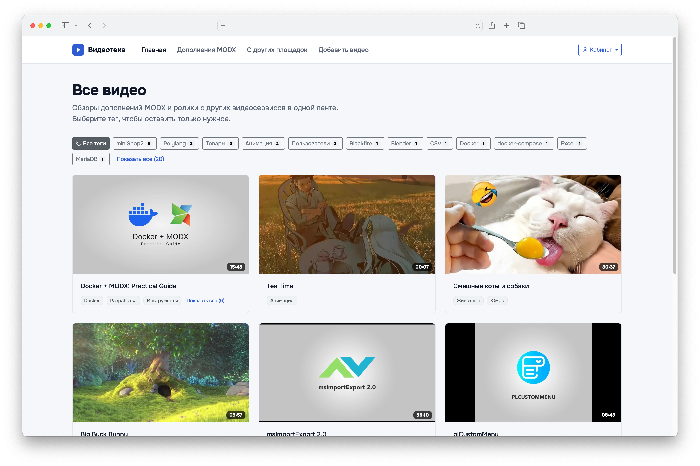
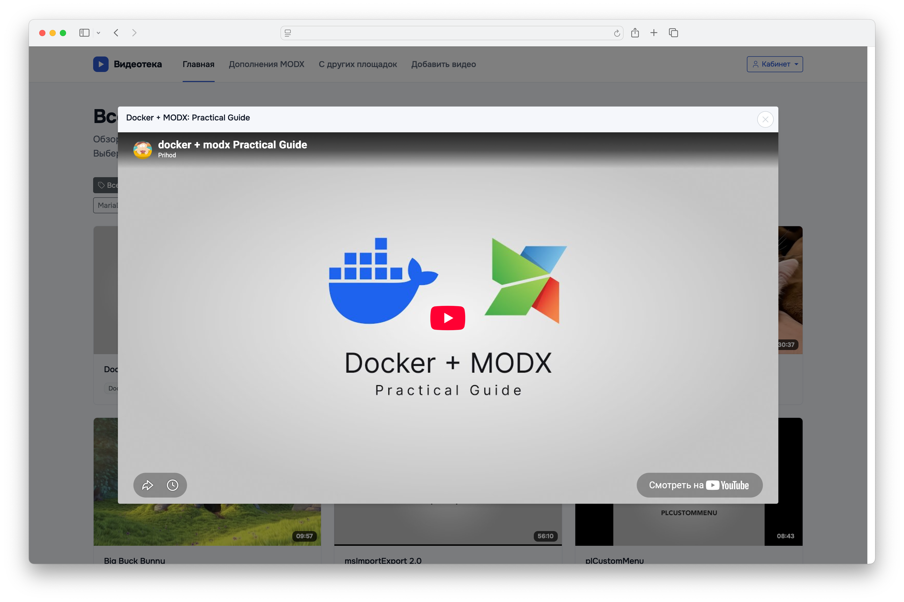
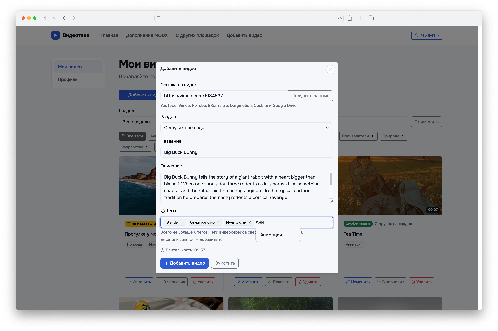
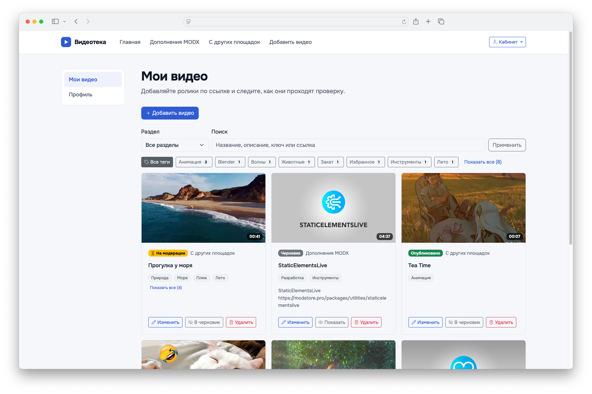
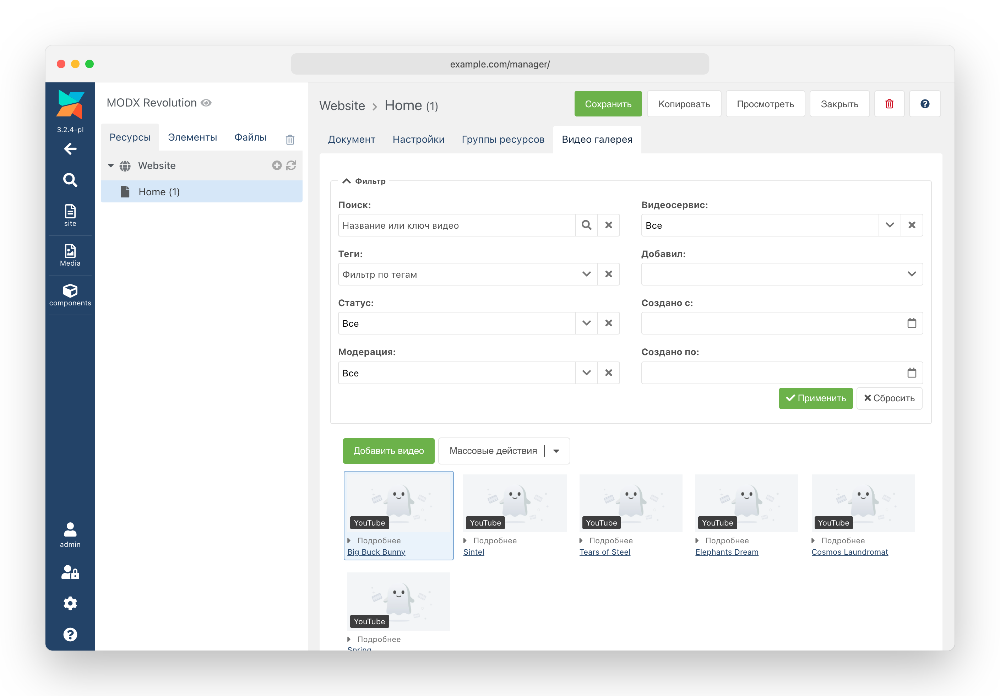
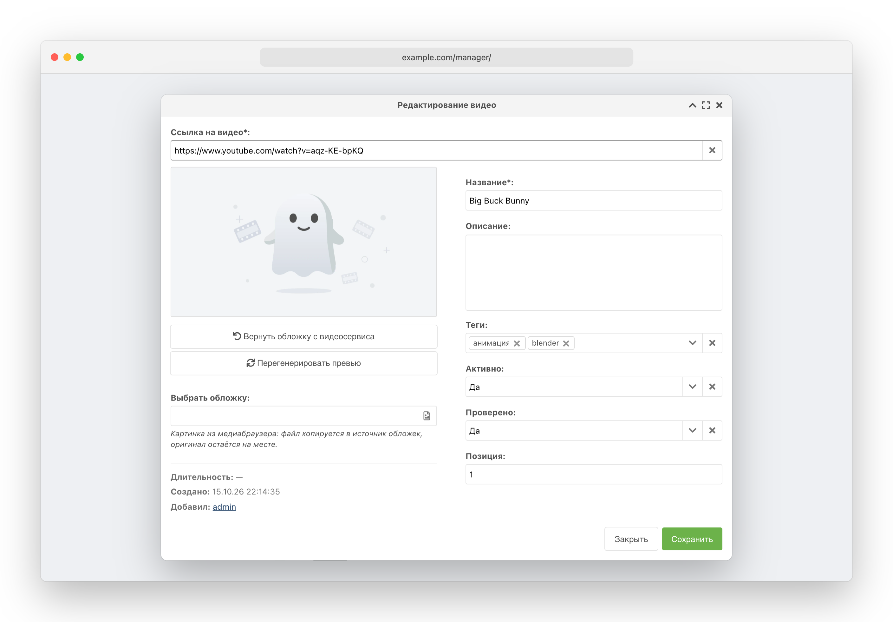
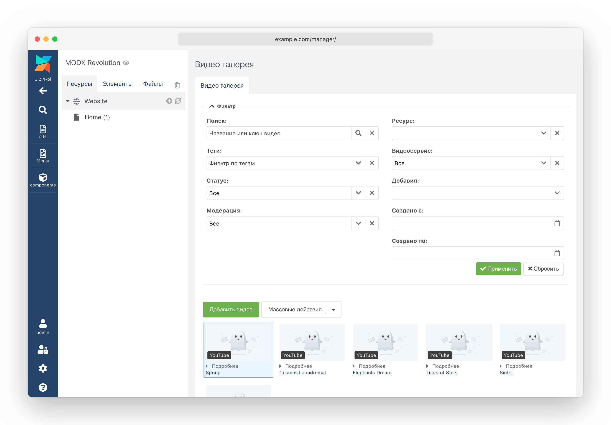

ResVideoGallery – компонент MODX Revolution 3.x для видеогалерей на сайте. Видео с YouTube, Vimeo, RuTube, ВКонтакте, Dailymotion, Coub, Google Drive, TikTok, Instagram и Facebook привязываются к ресурсам, выводятся с облаком тегов и проигрываются в модальном окне или прямо в карточке. Посетители могут сами добавлять видео по ссылке, авторы — управлять своими видео в личном кабинете, администратор — проверять их перед публикацией.

Требования: MODX Revolution 3.x, PHP >= 8.4, pdoTools.

## Оглавление

* [Основные возможности компонента](#основные-возможности-компонента)
* [Демонстрация](#демонстрация)
* [Установка](#установка)
* [Быстрый старт](#быстрый-старт)
* [Поддерживаемые видеосервисы](#поддерживаемые-видеосервисы)
* [Работа в админке](#работа-в-админке)
* [Сниппеты](#сниппеты)
* [Чанки и плейсхолдеры](#чанки-и-плейсхолдеры)
* [Системные настройки](#системные-настройки)
* [Модерация](#модерация)
* [Безопасность](#безопасность)
* [Настройка CSS стилей](#настройка-css-стилей)
* [JavaScript](#javascript)
* [REST API](#rest-api)
* [Системные события MODX](#системные-события-modx)
* [Для разработчиков: запись видео из кода](#для-разработчиков-запись-видео-из-кода)

## Основные возможности компонента

**Галерея**
* Видео привязываются к ресурсам: вкладка «Видео галерея» на странице ресурса, у каждого ресурса свой порядок видео.
* Вывод видео через pdoTools (в том числе с постраничной навигацией pdoPage и подгрузкой по кнопке).
* Облако тегов с фильтрацией галереи, сортировкой по популярности и сворачиванием длинного списка.
* Проигрывание в модальном окне или прямо в карточке, автозапуск.
* Пять готовых эффектов при наведении на карточку.

**Видеосервисы**
* YouTube, Vimeo, RuTube, ВКонтакте, Dailymotion, Coub, Google Drive, TikTok, Instagram и Facebook.
* Название, описание, длительность, обложка и теги подтягиваются с видеосервиса по ссылке.
* Короткие ссылки TikTok и Facebook (`vm.tiktok.com/…`, `fb.watch/…`) разворачиваются в полный адрес.
* Вертикальные ролики (TikTok, Instagram, Facebook Reels) проигрываются в вертикальном окне 9:16.
* Обложки сохраняются на своём сервере в выбранном медиа-источнике, превью нужных размеров и форматов (в том числе WebP и AVIF) собираются автоматически.

**Видео от посетителей**
* Форма добавления видео по ссылке — на странице или в модальном окне.
* Гостям или только авторизованным, по группам пользователей; лимит видео на пользователя и суточный лимит для гостя.
* Свои теги посетителя с подсказками, лимит тегов, режим «только существующие теги».
* Выбор раздела, в который попадёт видео.

**Мои видео**
* Личный список видео автора со статусами «Опубликовано», «Черновик», «На модерации».
* Правка названия, описания и тегов, снятие с публикации и удаление — каждое действие включается отдельно.
* Облако тегов, поиск и фильтр по разделам.

**Модерация**
* Видео посетителя появляется на сайте только после одобрения в админке.
* Повторная проверка после правки автором.
* Группы пользователей, чьи видео публикуются без проверки.

**Безопасность**
* Защита от CSRF-атак, ограничение частоты запросов.
* reCAPTCHA 3 и Yandex SmartCaptcha.
* Корректная работа за Cloudflare и другими reverse-proxy.
* Параметры форм подписаны на сервере — их нельзя подменить из браузера.

**Для разработчиков**
* Системные события на загрузку, сохранение и удаление видео — с возможностью отказать в действии или изменить данные.
* Открытый REST API.
* Настройка вида через CSS-переменные, JS-событие о добавлении видео.

## Демонстрация

[](https://raw.githubusercontent.com/Prihod/modx-extras-docs/main/ResVideoGallery/images/gallery.png)

*Галерея с облаком тегов и постраничной навигацией.*

[](https://raw.githubusercontent.com/Prihod/modx-extras-docs/main/ResVideoGallery/images/player.png)

*Проигрывание видео в модальном окне.*

[](https://raw.githubusercontent.com/Prihod/modx-extras-docs/main/ResVideoGallery/images/upload.png)

*Форма добавления видео посетителем: данные подтянулись с видеосервиса по ссылке.*

[](https://raw.githubusercontent.com/Prihod/modx-extras-docs/main/ResVideoGallery/images/author.png)

*«Мои видео»: статусы, облако тегов, поиск и действия автора.*

## Установка

Установите транспортный пакет ResVideoGallery через стандартный менеджер пакетов MODX (Приложения → Установщик).

**Зависимости:**

* [pdoTools](https://docs.modx.pro/components/pdotools/) — обязательно: сниппеты выбирают видео через pdoFetch, чанки рендерятся через pdoTools (Fenom).
  Рекомендуется pdoTools 3.1.0 и новее. В более ранних версиях 3.x (например, 3.0.3-pl2) есть две ошибки самого pdoTools, которые пишут в журнал ошибок MODX, но на работу галереи не влияют:
  * `Array to string conversion` в `Fetch.php` при каждом выводе галереи: журнал pdoFetch не умеет выводить вложенные группы условий;
  * `Undefined variable $showLog`, когда страницу открывает вошедший в менеджер пользователь: pdoPage обращается к параметру, которого нет в его свойствах. Если обновить pdoTools нельзя, передайте pdoPage `&showLog=`0``.
* Bootstrap 5.3 на сайте — чанки сайта свёрстаны на его классах. Нужны только стили: JavaScript Bootstrap компоненту не нужен.
* jQuery — только для pdoPage с подгрузкой без перезагрузки страницы (`&ajaxMode`): этого требует сам pdoPage. Компоненту jQuery не нужен.

**Первичная настройка:**

1. **Медиа-источник обложек.** При установке компонент сам создаёт файловый медиа-источник «ResVideoGallery Covers» с каталогом `assets/images/videos/` и прописывает его в настройку `resvideogallery_cover_source`. Хотите хранить обложки в другом месте (например, в облачном хранилище) — укажите свой источник в этой настройке: при обновлении пакета выбранный источник не меняется. При необходимости поменяйте набор размеров превью (`resvideogallery_cover_sizes`) — см. «Обложки» в разделе «Системные настройки».
2. **Ключи API.** Для YouTube нужен ключ YouTube Data API v3 (`resvideogallery_youtube_api_key`), для Google Drive — ключ Google Drive API (`resvideogallery_google_drive_api_key`). Остальные видеосервисы работают без ключей. Подробнее — в разделе «Поддерживаемые видеосервисы».
3. **Шаблоны.** По умолчанию вкладка «Видео галерея» появляется у ресурсов с любым шаблоном. Ограничить её нужными шаблонами — настройкой `resvideogallery_working_templates`.
4. **Приём видео от посетителей** по умолчанию выключен. Если на сайте будет форма добавления, включите `resvideogallery_upload_enabled` и проверьте настройки в разделах «Добавление видео посетителями» и «Модерация».

## Быстрый старт

Все сниппеты читают параметры запроса (фильтр по тегу, поиск, страница), поэтому вызывайте их **некэшированными** — `[[!…]]`. Исключение — форма добавления видео: её можно вызывать и кэшированной (см. описание сниппета **ResVideoGalleryUpload**).

### Галерея с облаком тегов и постраничной навигацией

```html
[[!ResVideoGalleryTags? &tagsVisible=`15`]]

<div id="pdopage">
    <div class="rows rvg-gallery rvg-hover-reveal row g-3">
        [[!pdoPage?
        &element=`ResVideoGallery`
        &limit=`12`
        &ajaxMode=`button`
        &tplWrapper=``
        ]]
    </div>
    <div class="d-flex justify-content-center mt-4">[[!+page.nav]]</div>
</div>
```

pdoPage передаёт сниппету все свои параметры, поэтому обёртку галереи отключают (`&tplWrapper=```), а контейнер карточек пишут в разметке страницы — внутри `#pdopage`, с классом `rows`. Класс `rvg-hover-reveal` задаёт эффект при наведении — см. «Настройка CSS стилей».

Без pdoPage достаточно одного вызова — контейнер даст чанк-обёртка `resvideogallery.gallery`:

```html
[[!ResVideoGallery? &limit=`0`]]
```

По умолчанию выводятся видео текущего ресурса. Видео других ресурсов — параметрами `&resources` и `&parents`.

### Форма добавления видео

```html
[[!ResVideoGalleryUpload? &modal=`1`]]
```

С `&modal=`1`` на странице выводится кнопка «Добавить видео», форма открывается в окне. Без него форма выводится прямо на странице. Видео попадает в текущий ресурс; разделы на выбор посетителю — параметром `&resources`.

### Мои видео

```html
[[!ResVideoGalleryUpload? &modal=`1` &modalSuccess=`insert`]]

[[!pdoPage?
&element=`ResVideoGalleryAuthor`
&limit=`12`
&tplWrapper=`resvideogallery.author`
]]
<div class="d-flex justify-content-center mt-4">[[!+page.nav]]</div>
```

Список видит только вошедший на сайт пользователь, гостю сниппет ничего не выводит. С `&modalSuccess=`insert`` добавленное через окно видео сразу появляется в списке без перезагрузки страницы.

Для «Моих видео» pdoPage вызывается **без `ajaxMode`**, а обёртка `resvideogallery.author` передаётся явно: в ней лежат подписанные параметры списка и адрес API, без неё кнопки карточек работать не будут.

Подробную информацию по всем параметрам каждого сниппета смотрите в разделе «**Сниппеты**».

## Поддерживаемые видеосервисы

Видеосервис определяется по ссылке автоматически. Узнаются только ссылки со схемой `http` или `https`.

| Видеосервис  | Какие ссылки узнаются                                                                                                           | Что нужно                                                           | Что подтягивается                                              |
|--------------|---------------------------------------------------------------------------------------------------------------------------------|---------------------------------------------------------------------|----------------------------------------------------------------|
| YouTube      | `youtube.com/watch?v=…`, `youtube.com/shorts/…`, `youtube.com/embed/…`, `youtu.be/…`, `youtube-nocookie.com/embed/…`              | Ключ YouTube Data API v3 в `resvideogallery_youtube_api_key`        | Название, описание, длительность, обложка, теги                |
| Vimeo        | `vimeo.com/<id>`, `vimeo.com/<id>/<hash>` (видео «по ссылке»), `player.vimeo.com/video/<id>`, ссылки из каналов и групп          | —                                                                   | Название, описание, длительность, обложка                      |
| RuTube       | `rutube.ru/video/…`, `rutube.ru/video/private/…`, `rutube.ru/shorts/…`, `rutube.ru/play/embed/…`                                 | —                                                                   | Название, описание, длительность, обложка, теги                |
| ВКонтакте    | `vk.com/video-…_…`, `vkvideo.ru/video-…_…` (страница ролика), `vk.com/video_ext.php?oid=…&id=…&hash=…`, `vkvideo.ru/video_ext.php?…` (плеер) | —                                                          | Название, описание, длительность, обложка                      |
| Dailymotion  | `dailymotion.com/video/…`, `dailymotion.com/embed/video/…`, `dai.ly/…`                                                            | —                                                                   | Название, описание, длительность, обложка, теги                |
| Coub         | `coub.com/view/…`, `coub.com/embed/…`                                                                                            | —                                                                   | Название, описание, длительность, обложка, теги                |
| Google Drive | `drive.google.com/file/d/<id>/…`                                                                                                 | Ключ Google Drive API в `resvideogallery_google_drive_api_key`; доступ к файлу «Все, у кого есть ссылка» | Название, описание, длительность, обложка                      |
| TikTok       | `tiktok.com/@автор/video/<id>`, `tiktok.com/embed/…`, `tiktok.com/player/v1/…`; короткие `vm.tiktok.com/…`, `vt.tiktok.com/…`, `tiktok.com/t/…` | —                                                  | Название, описание, обложка, теги (из хэштегов подписи)        |
| Instagram    | `instagram.com/p/…`, `instagram.com/reel/…`, `instagram.com/reels/…`, `instagram.com/tv/…` (в том числе с именем пользователя и `/embed`), `instagr.am/p/…` | —                              | Обложка                                                        |
| Facebook     | `facebook.com/<страница>/videos/<id>`, `facebook.com/watch/?v=<id>`, `facebook.com/reel/<id>`, код встраивания `facebook.com/plugins/video.php?href=…`; короткие `fb.watch/…`, `facebook.com/share/v/…`, `facebook.com/share/r/…` | —                 | Название, описание, теги (из хэштегов) — у обычных видео; обложка |

**Ключи API Google.** Ограничивайте ключ **по IP-адресу сервера**, а не по HTTP referrer: запросы к API идут с сервера и заголовка `Referer` не содержат, поэтому ключ с ограничением по сайту Google отклонит. Квота YouTube Data API считается на проект Google Cloud, а не на ключ: новый ключ в том же проекте исчерпанную квоту не вернёт. Когда квота закончилась, менеджер и посетитель видят сообщение об исчерпанном лимите запросов.

**ВКонтакте.** Ключ не нужен: данные берутся со страницы плеера `video_ext.php`. Для открытого ролика достаточно ссылки на его страницу (`vk.com/video-…`, `vkvideo.ru/video-…`, в том числе открытого поверх ленты — `vk.com/video?z=video-…`). Скрытый ролик, доступный только по ссылке, ВКонтакте отдаёт на встраивание лишь с параметром `hash` — для него нужна ссылка на плеер: в меню ролика «Поделиться» → «Экспортировать», адрес из `src` кода вставки (с `vk.com` или `vkvideo.ru`, подходят оба).

**Google Drive.** Ролик должен быть открыт по ссылке для всех: закрытый файл посетитель всё равно не посмотрит. Настройка `resvideogallery_google_drive_html5_player` показывает ролики Google Drive в теге `<video>` вместо плеера Google; файлы крупнее ~100 МБ Google может не отдать, и тогда ролик не заиграет.

**TikTok, Instagram, Facebook.** Ключи и токены не нужны. Длительность ни один из трёх сервисов не отдаёт — поле остаётся пустым. Instagram и ролики Facebook Reels не отдают и названия: его вписывают вручную (в форме посетителя поле «Название» тогда обязательно). Обложки Instagram и Facebook берутся со страниц встраивания этих сервисов; если автор ролика запретил встраивание, обложки не будет — выберите свою.

**Короткие ссылки** TikTok и Facebook сервер разворачивает при сохранении, в «Получить данные» и в форме посетителя; в базу ложится полный адрес ролика. Для этого серверу нужен доступ в интернет. Переходы идут только по `https` и только внутри доменов самого видеосервиса. Если ссылка устарела (TikTok уводит её на свою главную) или Facebook не пустил сервер без входа, появится ошибка — вставьте полный адрес ролика.

**Вертикальные ролики.** TikTok, Instagram и Facebook Reels (ссылка вида `facebook.com/reel/…`) проигрываются в вертикальном окне 9:16, а в режиме `inline` карточка на время проигрывания вытягивается по высоте. Сетка карточек остаётся 16:9: вертикальная обложка обрезается по центру.

**Теги с видеосервиса** сохраняются не больше 30 — первые в порядке, в котором их отдал сервис; повторы, отличающиеся только регистром, отбрасываются.

**Если видеосервис отказал**, текст ошибки объясняет причину: ссылку не узнал ни один видеосервис; видеосервис не знает такого ролика; видеосервис не настроен (нет ключа API); исчерпан лимит запросов; не удалось развернуть короткую ссылку; видеосервис не ответил.

## Работа в админке

### Вкладка «Видео галерея» на странице ресурса

Видео принадлежат ресурсу, поэтому управление ими живёт на странице ресурса — во вкладке «Видео галерея». Вкладка появляется у сохранённого ресурса с шаблоном из настройки `resvideogallery_working_templates` (пусто — у любого шаблона).

<!-- screenshot: manager-tab | Вкладка «Видео галерея» на странице ресурса: фильтр и карточки видео -->
[](https://raw.githubusercontent.com/Prihod/modx-extras-docs/main/ResVideoGallery/images/manager-tab.png)

Каждое видео — карточка: обложка, длительность, отметка «На модерации» и сворачиваемый блок «Подробнее» с id, позицией и автором (раскрыт он по умолчанию или свёрнут — настройка `resvideogallery_card_meta_expanded`). Клик по названию открывает видео на видеосервисе.

* **Порядок видео** меняется перетаскиванием карточек или числом в поле «Позиция» окна видео.
* **Выделение** нескольких карточек — с Ctrl/⌘ или Shift.
* **Контекстное меню** карточки: «Редактировать», «Одобрить» (у видео на модерации), «Открыть на видеосервисе», «Вернуть обложку с видеосервиса» (если нынешняя обложка выбрана вручную), «Удалить».
* **Массовые действия:** включить, выключить, одобрить и удалить выбранные видео; «Перегенерировать превью» у всех видео ресурса — после смены набора размеров.
* **Удалить лишние файлы обложек** — пункт массовых действий на странице дополнения (Дополнения → ResVideoGallery, там видео всех ресурсов). Убирает из источника обложек каталоги удалённых видео и размеров, которых больше нет в `resvideogallery_cover_sizes`. Сначала показывает, сколько каталогов будет удалено, и удаляет только после подтверждения; каталоги, не похожие на обложки, не трогает и называет их число.
* **Фильтр** над видео: поиск по названию и ключу видео, теги, статус (активные/неактивные), модерация, видеосервис, автор, диапазон дат добавления.

### Окно видео

<!-- screenshot: manager-window | Окно видео: ссылка, обложка, теги и статусы -->
[](https://raw.githubusercontent.com/Prihod/modx-extras-docs/main/ResVideoGallery/images/manager-window.png)

* **Ссылка на видео.** Данные с видеосервиса подтягиваются сами — сразу после вставки ссылки или через полсекунды после ручного ввода. Если автоматический запрос не случился, его запускает кнопка в поле ссылки; пока идёт запрос, на кнопке крутится индикатор. Когда данные получены, та же кнопка (крестик) очищает форму: ссылку, название, описание, теги и выбранную обложку. Статус, модерация и позиция при очистке не меняются. Если поля уже заполнены, перед заменой окно спросит подтверждение.
* **Обложка.** По умолчанию берётся обложка видеосервиса. Свою картинку выбирают через «Выбрать обложку» — в медиабраузере можно и загрузить файл с компьютера (jpg, png, webp, avif). Файл копируется в источник обложек, оригинал остаётся на месте. Кнопки «Вернуть обложку с видеосервиса» и «Перегенерировать превью» работают у сохранённого видео.
* **Теги** — чипами, с подсказками из тегов, которые уже есть на сайте; новые теги можно вписывать.
* **Активно** — видео выводится на сайте. **Проверено** — видео прошло модерацию (см. «Модерация»).

### Страница компонента

<!-- screenshot: manager-page | Страница компонента: видео всех ресурсов -->


Страница «Видео галерея» в меню компонентов показывает видео всех ресурсов (новые сверху) с тем же фильтром и полем «Ресурс». Перетаскивания здесь нет: порядок видео имеет смысл только внутри одного ресурса.

### Права доступа
<!-- inventory: permissions -->

| Право                          | Что даёт                                                                              |
|--------------------------------|---------------------------------------------------------------------------------------|
| `resvideogallery_menu`         | Пункт меню компонента                                                                 |
| `resvideogallery_videos_list`  | Просмотр списка видео и подсказок тегов                                               |
| `resvideogallery_videos_view`  | Открытие видео в окне                                                                 |
| `resvideogallery_videos_save`  | Создание и правка видео, порядок, включение и выключение, одобрение, работа с обложками |
| `resvideogallery_videos_remove`| Удаление видео                                                                        |

Все пять прав входят в политику доступа **ResVideoGalleryPolicy** — её создаёт установка компонента. Чтобы дать права группе пользователей, назначьте группе эту политику.

### Очистка корзины

При очистке корзины ресурсов удаляются и видео удалённых ресурсов — вместе с тегами и обложками. Удаляются видео только тех ресурсов, которые MODX действительно удалил. Для каждого видео вызываются события удаления (см. «Системные события MODX»), и плагин может сохранить видео, отказав в удалении.

## Сниппеты
<!-- inventory: snippets -->

### ResVideoGallery - Вывод галереи видео

Выводит видео ресурсов. Работает самостоятельно или как элемент **pdoPage**. Видео, ожидающие модерации, не выводятся никогда.

**Параметры**

| Имя              | Описание                                                                                                                                                                                                                                                                        |
|------------------|---------------------------------------------------------------------------------------------------------------------------------------------------------------------------------------------------------------------------------------------------------------------------------|
| resources        | Id ресурсов через запятую, чьи видео выводятся. Минус перед id исключает ресурс. Если не заданы ни `resources`, ни `parents` — видео текущего ресурса.                                                                                                                           |
| parents          | Id родителей через запятую: выводятся видео их дочерних ресурсов (сам родитель не входит).                                                                                                                                                                                       |
| depth            | Глубина поиска дочерних ресурсов для `parents`. По умолчанию: 10.                                                                                                                                                                                                               |
| showInactive     | Выводить и выключенные видео, и видео вне периода публикации. По умолчанию: 0.                                                                                                                                                                                                  |
| tags             | Выводить только видео с этими тегами (через запятую, достаточно любого).                                                                                                                                                                                                        |
| tagsVar          | Имя GET-параметра фильтра по тегам — по нему фильтрует облако тегов **ResVideoGalleryTags**. По умолчанию: tags.                                                                                                                                                                |
| player           | Где проигрывать видео: `modal` — в модальном окне, `inline` — прямо в карточке. По умолчанию: modal.                                                                                                                                                                             |
| autoPlay         | Запускать видео сразу после открытия плеера. По умолчанию: 1.                                                                                                                                                                                                                   |
| coverSize        | Размер превью обложки из набора `resvideogallery_cover_sizes`. Пусто — из настройки `resvideogallery_cover_default_size`.                                                                                                                                                         |
| videoTagsLimit   | Сколько тегов видео выводить на карточке. 0 — все. По умолчанию: 0.                                                                                                                                                                                                             |
| videoTagsVisible | Сколько тегов видео показать сразу, остальные — под кнопкой «Показать все (N)». 0 — все. По умолчанию: 0.                                                                                                                                                                         |
| tpl              | Чанк карточки. По умолчанию: resvideogallery.card.                                                                                                                                                                                                                              |
| tplWrapper       | Чанк-обёртка всех карточек, плейсхолдер `{$output}`. Пустое значение отключает обёртку — так нужно при вызове через pdoPage. По умолчанию: resvideogallery.gallery.                                                                                                              |
| wrapIfEmpty      | Выводить обёртку, даже если видео нет (в ней — текст «Видео не найдены»). По умолчанию: 1.                                                                                                                                                                                      |
| limit            | Сколько видео выводить. 0 — все. По умолчанию: 12.                                                                                                                                                                                                                              |
| offset           | Сколько видео пропустить от начала выборки. По умолчанию: 0.                                                                                                                                                                                                                    |
| sortby           | Сортировка — поле видео с алиасом `RvgVideo.` или JSON. Пусто — по позиции в ресурсе.                                                                                                                                                                                            |
| sortdir          | Направление сортировки: ASC или DESC.                                                                                                                                                                                                                                           |
| where            | Дополнительные условия выборки в формате JSON.                                                                                                                                                                                                                                  |
| return           | Что вернуть: `data` — HTML карточек, `json` — данные видео в JSON, `ids` — id видео через запятую. По умолчанию: data.                                                                                                                                                             |
| toPlaceholder    | Записать результат в этот плейсхолдер вместо вывода.                                                                                                                                                                                                                             |
| outputSeparator  | Разделитель между карточками. По умолчанию — перевод строки.                                                                                                                                                                                                                    |
| totalVar         | Плейсхолдер с общим числом видео (его читает pdoPage). По умолчанию: total.                                                                                                                                                                                                      |
| showLog          | Показать журнал pdoTools менеджеру. По умолчанию: 0.                                                                                                                                                                                                                             |

Остальные параметры (`select`, `leftJoin`, `groupby` и т. п.) передаются в pdoFetch как есть. Имена полей в условиях и сортировке указывайте с алиасом `RvgVideo.`: `rank` — зарезервированное слово MySQL 8.

**Пример вызова**
```html
[[!ResVideoGallery?
&parents=`5`
&limit=`8`
&player=`inline`
&videoTagsVisible=`3`
]]
```

### ResVideoGalleryTags - Облако тегов для фильтра галереи

Выводит теги видео тех же ресурсов, что и галерея. Ссылка тега фильтрует галерею на текущей странице (GET-параметр `tagsVar`) и сбрасывает страницу pdoPage. Выбранный тег виден всегда, даже если не вошёл в лимит.

**Параметры**

| Имя          | Описание                                                                                                                                 |
|--------------|------------------------------------------------------------------------------------------------------------------------------------------|
| resources    | Id ресурсов через запятую, минус исключает. По умолчанию — текущий ресурс. Задавайте так же, как у галереи.                               |
| parents      | Id родителей через запятую.                                                                                                              |
| depth        | Глубина поиска дочерних ресурсов. По умолчанию: 10.                                                                                      |
| showInactive | Учитывать теги выключенных видео. По умолчанию: 0.                                                                                       |
| tagsVar      | Имя GET-параметра фильтра по тегам. По умолчанию: tags.                                                                                  |
| pageVarKey   | Имя GET-параметра страницы pdoPage — ссылки облака его сбрасывают. По умолчанию: page.                                                    |
| sortby       | Порядок: `count` — сначала популярные, `tag` — по алфавиту. По умолчанию: count.                                                          |
| limit        | Сколько тегов выводить. 0 — все. По умолчанию: 0.                                                                                        |
| tagsVisible  | Сколько тегов показать сразу, остальные — под кнопкой «Показать все (N)». 0 — все. По умолчанию: 0.                                       |
| tpl          | Чанк облака. По умолчанию: resvideogallery.tags.                                                                                         |

**Пример вызова**
```html
[[!ResVideoGalleryTags? &limit=`30` &tagsVisible=`12`]]
```

### ResVideoGalleryUpload - Форма добавления видео посетителем

Выводит форму добавления видео по ссылке: посетитель вставляет ссылку, данные подтягиваются с видеосервиса сами, при желании он правит название, описание и теги. Пока настройка `resvideogallery_upload_enabled` выключена, сниппет ничего не выводит.

Пустой параметр означает «как в системной настройке»; параметр перекрывает настройку.

**Параметры**

| Имя                  | Описание                                                                                                                                                                                                   |
|----------------------|------------------------------------------------------------------------------------------------------------------------------------------------------------------------------------------------------------|
| resource             | Id одного ресурса: видео всегда попадает в него. Вместе с `resources` складывается в общий список.                                                                                                         |
| resources            | Id ресурсов через запятую, куда посетитель может добавить видео. Один — видео попадает в него, несколько — посетитель выбирает раздел в форме. Пусто — из настройки `resvideogallery_upload_resources`, а если пусто и там — текущий ресурс. |
| onlyAuth             | 1 — только авторизованным, 0 — и гостям. Пусто — из настройки `resvideogallery_upload_only_auth`.                                                                                                         |
| userGroups           | Имена групп пользователей через запятую, которым можно добавлять видео. Пусто — из настройки `resvideogallery_upload_user_groups`.                                                                         |
| moderation           | 1 — видео ждёт проверки, 0 — сразу на сайте. Пусто — из настройки `resvideogallery_moderation`.                                                                                                           |
| moderationSkipGroups | Имена групп через запятую, чьи видео не проходят модерацию. Пусто — из настройки `resvideogallery_moderation_skip_groups`.                                                                                 |
| allowTags            | 1 — посетитель может дописать к тегам видеосервиса свои (не больше 10). Пусто — из настройки `resvideogallery_upload_allow_tags`.                                                                          |
| newTags              | 1 — можно вписать любой тег, 0 — только выбрать из тегов, которые уже есть у видео на сайте. Пусто — из настройки `resvideogallery_upload_new_tags`.                                                        |
| tagsSuggestMin       | Со скольких введённых символов показывать подсказки тегов (от 1 до 10). По умолчанию: 2.                                                                                                                  |
| tagsMax              | Сколько всего тегов может быть у видео вместе с тегами видеосервиса. 0 — без ограничения. Пусто — из настройки `resvideogallery_upload_tags_max`.                                                          |
| tagsRemove           | 1 — посетитель может убрать теги, пришедшие с видеосервиса. Пусто — из настройки `resvideogallery_upload_tags_remove`.                                                                                    |
| tpl                  | Чанк формы. По умолчанию: resvideogallery.upload.                                                                                                                                                          |
| modal                | 1 — вместо формы кнопка, форма открывается в модальном окне. По умолчанию: 0.                                                                                                                              |
| modalButton          | **Ключ лексикона** текста кнопки (не сам текст). По умолчанию: resvideogallery_upload_modal_button.                                                                                                        |
| modalButtonClass     | CSS-класс кнопки. По умолчанию: btn btn-primary.                                                                                                                                                           |
| modalSuccess         | Что делать после успешной отправки: `stay` — окно остаётся открытым, форма очищается; `close` — окно закрывается, сообщение выводится под кнопкой; `insert` — как `close`, и видео сразу появляется в «Моих видео» на этой же странице. По умолчанию: stay. |
| modalCloseDelay      | Через сколько миллисекунд закрыть окно в режимах `close` и `insert` (от 0 до 60000). По умолчанию: 2000.                                                                                                  |
| tplModal             | Чанк кнопки и окна. По умолчанию: resvideogallery.upload.modal.                                                                                                                                            |

**Как устроена форма**
* Данные о ролике подтягиваются сами — сразу при вставке ссылки и через 600 мс после ручного ввода. Вписанные посетителем название и описание автозапрос не затирает. Кнопка «Получить данные» подставляет всё заново.
* Теги видеосервиса сервер берёт заново при отправке — присланному формой он не доверяет. Лимит «10 своих тегов» не настраивается.
* При `&tagsMax` сначала идут теги видеосервиса (без убранных посетителем), затем свои; всё сверх лимита не сохраняется. Лишние теги видеосервиса в форме видны, но выделены.
* При `&newTags=`0`` «существующие теги» — ровно то, что показывают подсказки: теги видео, которые видны на сайте, в разделах формы. Тег короче `&tagsSuggestMin` выбрать нельзя — ставьте порог не больше длины самых коротких тегов сайта.
* Кнопка «Очистить» очищает поля, теги и сведения о ролике.
* Лимиты на количество видео задаются только настройками: `resvideogallery_upload_limit` (всего на пользователя) и `resvideogallery_upload_guest_daily_limit` (гостю в сутки с одного адреса).

**Кэширование.** Форму можно вызывать кэшированной: в разметку попадают только адрес API и подписанные параметры формы, а всё, что зависит от посетителя (пускать ли его, лимиты, CSRF-токен), форма запрашивает у сервера при загрузке страницы. Но если вы поменяли **параметры вызова** или настройку, которую форма показывает (поле тегов, лимит тегов), — сбросьте кэш страницы: в кэше лежит разметка со старыми значениями.

**Пример вызова**
```html
[[!ResVideoGalleryUpload?
&resources=`5,6,7`
&onlyAuth=`0`
&allowTags=`1`
&tagsMax=`15`
&modal=`1`
]]
```

### ResVideoGalleryAuthor - Мои видео

Выводит видео вошедшего пользователя — опубликованные, черновики и ожидающие проверки — со статусами и кнопками действий. Гостю сниппет ничего не выводит. Работает самостоятельно или как элемент **pdoPage** (без `ajaxMode`).

Вызывайте **только некэшированным** `[[!ResVideoGalleryAuthor]]`: кэшированный вызов положит список первого посетителя в кэш страницы для всех.

**Параметры**

| Имя                  | Описание                                                                                                                                                                                  |
|----------------------|-------------------------------------------------------------------------------------------------------------------------------------------------------------------------------------------|
| resources            | Id разделов через запятую, видео которых показываются автору. Пусто — все разделы.                                                                                                        |
| resourceVar          | Имя GET-параметра фильтра по разделу. По умолчанию: rvg_resource.                                                                                                                         |
| allowRemove          | 1 — автор может удалить своё видео. Пусто — из настройки `resvideogallery_allow_remove`.                                                                                                  |
| allowDraft           | 1 — автор может снять видео с сайта в черновик и вернуть обратно. Пусто — из настройки `resvideogallery_allow_draft`.                                                                      |
| allowEdit            | 1 — автор может править название и описание. Пусто — из настройки `resvideogallery_allow_edit`.                                                                                            |
| allowTags            | 1 — автор может править теги (только вместе с `allowEdit`). Пусто — из настройки `resvideogallery_allow_edit_tags`.                                                                        |
| newTags              | 1 — можно вписать любой тег, 0 — только выбрать из существующих. Пусто — из настройки `resvideogallery_edit_new_tags`.                                                                     |
| tagsSuggestMin       | Со скольких введённых символов показывать подсказки тегов (от 1 до 10). По умолчанию: 2.                                                                                                  |
| remoderation         | 1 — видео, у которого автор изменил название, описание или теги, снова уходит на проверку. Пусто — из настройки `resvideogallery_remoderation`.                                             |
| moderationSkipGroups | Имена групп через запятую, чьи видео не проходят повторную проверку. Пусто — из настройки `resvideogallery_moderation_skip_groups`.                                                        |
| tagVar               | Имя GET-параметра облака тегов. По умолчанию: rvg_tag.                                                                                                                                    |
| tplTags              | Чанк облака тегов. По умолчанию: resvideogallery.tags.                                                                                                                                    |
| tagsSortby           | Порядок облака: `count` — сначала популярные, `tag` — по алфавиту. По умолчанию: count.                                                                                                   |
| tagsLimit            | Сколько тегов показать в облаке. 0 — все. По умолчанию: 0.                                                                                                                                |
| tagsVisible          | Сколько тегов облака показать сразу, остальные — под кнопкой «Показать все (N)». 0 — все. По умолчанию: 0.                                                                                 |
| videoTagsLimit       | Сколько тегов видео выводить на карточке. 0 — все. По умолчанию: 0.                                                                                                                       |
| videoTagsVisible     | Сколько тегов видео показать сразу. 0 — все. По умолчанию: 0.                                                                                                                             |
| searchVar            | Имя GET-параметра поиска. По умолчанию: rvg_q.                                                                                                                                            |
| pageVarKey           | Имя GET-параметра страницы pdoPage. По умолчанию: page.                                                                                                                                   |
| coverSize            | Размер превью обложки. Пусто — из настройки `resvideogallery_cover_default_size`.                                                                                                         |
| tpl                  | Чанк карточки. По умолчанию: resvideogallery.author.card. Только имя чанка: `@INLINE` для списка сработает, но карточка, вставленная после добавления видео через окно, нарисуется чанком по умолчанию. |
| tplWrapper           | Чанк-обёртка. По умолчанию: resvideogallery.author. **Пустой её не делайте**: в ней лежат подписанные параметры списка и адрес API.                                                         |
| wrapIfEmpty          | Выводить обёртку, даже если видео нет. По умолчанию: 1.                                                                                                                                   |
| limit                | Сколько видео выводить. 0 — все. По умолчанию: 0.                                                                                                                                          |
| offset               | Сколько видео пропустить от начала выборки. По умолчанию: 0.                                                                                                                               |
| totalVar             | Плейсхолдер с общим числом видео (его читает pdoPage). По умолчанию: total.                                                                                                                |
| sortby               | Сортировка. Пусто — по дате добавления, новые сверху.                                                                                                                                     |
| sortdir              | Направление сортировки. Если задан `sortby`, а `sortdir` пуст — DESC.                                                                                                                      |
| toPlaceholder        | Записать результат в этот плейсхолдер вместо вывода.                                                                                                                                       |

Параметры `where`, `parents`, `tags` сниппет не принимает: выборку всегда составляет он сам — только видео автора.

**Возможности автора**
* **Статусы:** «Опубликовано», «Черновик», «На модерации». «В черновик» и «Опубликовать» статус проверки не меняют.
* **«Опубликовать»** ставит видео активным и тем самым отменяет «Выключить» менеджера. Спрятать видео от автора можно, сняв «Проверено»: его автор не меняет.
* **Облако тегов** — теги всех видео автора в выбранном разделе, включая черновики и видео на модерации. Раздел и тег фильтруют вместе; выбранный тег виден всегда.
* **Поиск** — по ссылке на ролик (точное совпадение), по ключу ролика или по тексту в названии и описании; от 2 символов.
* **Форма фильтра** выводится, если у автора есть хотя бы одно видео; выбор раздела — если разделов два и больше.
* **Кнопка ▶** на обложке открывает то же окно плеера, что у галереи.

**Пример вызова**
```html
[[!ResVideoGalleryAuthor?
&allowTags=`1`
&tagsVisible=`15`
&videoTagsVisible=`6`
]]
```

## Чанки и плейсхолдеры
<!-- inventory: chunks -->

Все чанки рендерятся через pdoTools, синтаксис — Fenom. Чтобы изменить оформление, создайте копию чанка и укажите её имя в параметре сниппета.

**Важно при правке чанков:**
* Выводите значения из базы и из запроса **только с модификатором `|esc`**. После Fenom MODX ещё раз разбирает HTML на теги `[[ ]]`, а `|e` их не экранирует: название ролика с видеосервиса вида `[[++mail_smtp_pass]]` вывело бы системную настройку.
* Сохраняйте атрибуты `data-rvg-*` — по ним работают скрипты компонента.

### resvideogallery.card
Карточка видео (сниппет **ResVideoGallery**, параметр `tpl`).

| Плейсхолдер          | Описание                                                                                                          |
|----------------------|-------------------------------------------------------------------------------------------------------------------|
| id                   | ID видео                                                                                                          |
| resource_id          | ID ресурса, которому принадлежит видео                                                                            |
| title, description   | Название и описание                                                                                               |
| url                  | Ссылка на видео на видеосервисе                                                                                   |
| provider, video_key  | Видеосервис (`youtube`, `vimeo`, `rutube`, `vkontakte`, `dailymotion`, `coub`, `googledrive`, `tiktok`, `instagram`, `facebook`) и ключ ролика |
| duration             | Длительность в секундах                                                                                           |
| duration_formatted   | Длительность вида `03:22` или `1:03:22`; пусто, если неизвестна                                                   |
| cover_url            | Адрес обложки нужного размера или заглушки                                                                        |
| cover_srcset         | Значение `srcset`: превью той же формы и формата, что `cover_url`, с шириной (`… 320w, … 640w`); пусто у заглушки |
| tags                 | Все теги видео                                                                                                    |
| tagBadges            | Теги для вывода на карточке с учётом `videoTagsLimit`: массив `{tag, extra}`, `extra` — тег под «Показать все»     |
| embed_url            | Адрес плеера видеосервиса; `embed_autoplay_url` — с автозапуском                                                  |
| player               | `iframe` или `html5` (Google Drive с настройкой `resvideogallery_google_drive_html5_player`); для `html5` — `src` и `mime_type` |
| player_mode          | `modal` или `inline` — из параметра `player`                                                                      |
| player_ratio         | Пропорция плеера: `16x9` или `9x16` (TikTok, Instagram, Facebook Reels)                                           |
| autoplay             | 1 — автозапуск                                                                                                    |
| idx                  | Порядковый номер карточки                                                                                         |
| active, moderated, rank, createdon, createdby, pub_date, unpub_date | Поля видео                                                              |

Кнопка воспроизведения — `button[data-rvg-play]` с атрибутами `data-rvg-mode`, `data-rvg-autoplay`, `data-embed`, `data-embed-autoplay`, `data-ratio`, `data-player`, `data-src`, `data-mime`, `data-title`; блок обложки — `[data-rvg-media]` (в режиме `inline` плеер встаёт на его место). Если в своём чанке карточки нет `data-ratio="{$player_ratio|esc}"`, все ролики проигрываются в 16:9.

Атрибут `sizes` картинки в чанке рассчитан на сетку `col-12 col-sm-6 col-lg-4` (три колонки на широком экране). Меняете сетку — поправьте и `sizes`, иначе браузер будет брать превью не того размера.

### resvideogallery.gallery
Обёртка галереи (сниппет **ResVideoGallery**, параметр `tplWrapper`).

| Плейсхолдер | Описание           |
|-------------|--------------------|
| output      | Готовые карточки   |

### resvideogallery.modal
Модальное окно плеера. Подключается один раз на страницу — галереей при `&player=`modal`` и «Моими видео». Параметром не задаётся: чтобы изменить окно, правьте сам чанк, сохранив атрибуты `data-rvg-modal`, `data-rvg-modal-title`, `data-rvg-modal-body`, `data-rvg-modal-close`.

### resvideogallery.tags
Облако тегов (сниппет **ResVideoGalleryTags**, параметр `tpl`; «Мои видео» — параметр `tplTags`).

| Плейсхолдер | Описание                                                                                                                        |
|-------------|---------------------------------------------------------------------------------------------------------------------------------|
| tags        | Массив тегов: `tag`, `count` (число видео), `active` (тег выбран), `url` (ссылка фильтра), `extra` (тег под «Показать все»)     |
| clearUrl    | Ссылка без фильтра по тегу                                                                                                      |
| hasActive   | Выбран ли хотя бы один тег                                                                                                      |

### resvideogallery.upload
Форма добавления видео (сниппет **ResVideoGalleryUpload**, параметр `tpl`).

| Плейсхолдер    | Описание                                                                        |
|----------------|---------------------------------------------------------------------------------|
| token          | Подписанные параметры формы                                                     |
| apiUrl         | Адрес REST API                                                                  |
| formId         | Уникальный id формы                                                             |
| resources      | Разделы на выбор (`id`, `pagetitle`) — только если их два и больше               |
| allowTags      | Выводить поле тегов                                                             |
| tagsExisting   | 1 — только существующие теги                                                    |
| tagsSuggestMin | Порог подсказок тегов                                                           |
| tagsMax        | Лимит тегов (0 — без лимита)                                                    |
| tagsRemove     | Можно убирать теги видеосервиса                                                 |
| modal          | Форма выводится в окне                                                          |

### resvideogallery.upload.modal
Кнопка и модальное окно формы (сниппет **ResVideoGalleryUpload** при `&modal=`1``, параметр `tplModal`).

| Плейсхолдер | Описание                                    |
|-------------|---------------------------------------------|
| form        | Готовая форма из чанка `tpl`                |
| formId      | Id формы                                    |
| buttonText  | Текст кнопки (из ключа `modalButton`)       |
| buttonClass | CSS-класс кнопки                            |
| success     | Режим после отправки: stay, close, insert   |
| delay       | Задержка закрытия окна, мс                  |

Окно формы не должно нести атрибут `data-rvg-modal` — иначе видео начнёт открываться в окне формы.

### resvideogallery.author
Обёртка «Моих видео» (сниппет **ResVideoGalleryAuthor**, параметр `tplWrapper`).

| Плейсхолдер              | Описание                                                          |
|--------------------------|-------------------------------------------------------------------|
| output                   | Готовые карточки                                                  |
| token, apiUrl, formId    | Подписанные параметры списка, адрес REST API, id списка           |
| cloud                    | Готовое облако тегов                                              |
| sections                 | Разделы для фильтра: `id`, `pagetitle`, `selected`                |
| showFilter, showSections | Выводить форму фильтра / выбор раздела                            |
| search, searchVar        | Строка поиска и имя её GET-параметра                              |
| selected, resourceVar    | Выбранный раздел и имя GET-параметра                              |
| selectedTag, tagVar      | Выбранный тег и имя GET-параметра                                 |
| hasFilter, resetUrl      | Задан ли фильтр; ссылка «Сбросить»                                 |
| filterAction, filterHidden, pageVar | Служебное для формы фильтра                            |

### resvideogallery.author.card
Карточка в «Моих видео» (сниппет **ResVideoGalleryAuthor**, параметр `tpl`). Все плейсхолдеры карточки галереи (кроме `idx`) и дополнительно:

| Плейсхолдер                             | Описание                                                            |
|-----------------------------------------|---------------------------------------------------------------------|
| status                                  | `published`, `draft` или `moderation`                               |
| statusText, statusBadge                 | Подпись статуса и класс бейджа Bootstrap                            |
| canRemove, canDraft, canEdit, canTags   | Какие действия доступны автору                                      |
| tagsExisting, tagsSuggestMin            | Режим и порог подсказок тегов в форме «Изменить»                    |
| resourceTitle                           | Название раздела                                                    |

В своём чанке карточки выводите значки тегов из `tagBadges`, а не из `tags`: к `tags` лимиты `videoTagsLimit` / `videoTagsVisible` не применяются. Кнопку ▶ в свой чанк нужно добавить самому.

## Системные настройки
<!-- inventory: settings -->

Настройки сгруппированы по областям (namespace `resvideogallery`).

### Галерея
* `resvideogallery_working_templates` — id шаблонов через запятую, у ресурсов с которыми появляется вкладка «Видео галерея». Минус запрещает шаблон: `-7` — все, кроме 7-го; запрет сильнее разрешения, `5,7,-7` оставит только 5-й. Пусто — любой шаблон.
* `resvideogallery_card_meta_expanded` — раскрывать блок «Подробнее» на карточках в админке. По умолчанию свёрнут.

### Видеосервисы
* `resvideogallery_youtube_api_key` — ключ YouTube Data API v3.
* `resvideogallery_google_drive_api_key` — ключ Google Drive API.
* `resvideogallery_google_drive_html5_player` — проигрывать ролики Google Drive в теге `<video>` вместо плеера Google. По умолчанию выключено.

### Обложки
* `resvideogallery_cover_source` — медиа-источник, куда записываются новые обложки. Уже сохранённые остаются в своём источнике. При установке, если настройка пуста, компонент создаёт источник «ResVideoGallery Covers» (`assets/images/videos/`). При удалении компонента источник и файлы обложек остаются.
* `resvideogallery_cover_sizes` — набор размеров превью в JSON: имя размера → `width`, `height`, `quality` (1–100), `mode` (`cover` — обрезать по размеру, `contain` — вписать, `max` — только уменьшать, `stretch` — растянуть), `format` (`jpg`, `png`, `webp`, `avif`). Имя размера — латиница в нижнем регистре, цифры и `_`. После изменения перегенерируйте превью (массовое действие во вкладке «Видео галерея»).
  Карточки на сайте отдают браузеру не одну картинку, а список `srcset`: размер по умолчанию и другие размеры **того же соотношения сторон и формата**. Браузер сам берёт превью под ширину колонки и плотность экрана — на телефоне легче, на ретине чётче. Размер другой формы (например, квадратный) или другого формата в список не попадает.
  ```json
  {
      "thumb": {"width": 320, "height": 180, "quality": 80, "mode": "cover", "format": "webp"},
      "medium": {"width": 640, "height": 360, "quality": 85, "mode": "cover", "format": "webp"},
      "large": {"width": 1280, "height": 720, "quality": 85, "mode": "cover", "format": "webp"}
  }
  ```
* `resvideogallery_cover_default_size` — какой размер обложки показывать у видео в админке и на сайте (на сайте — вместе с остальными размерами той же формы в `srcset`). По умолчанию: `medium`.
* `resvideogallery_cover_placeholder` — картинка для видео без обложки, можно использовать `{assets_url}`. По умолчанию — заглушка компонента `{assets_url}components/resvideogallery/img/cover-placeholder.webp`.

Обложка хранится в источнике как оригинал `<id видео>/<хэш>.<расширение>` и превью `<id видео>/<размер>/<хэш>.<формат>`. При удалении видео каталог удаляется целиком.

### Фронт сайта
* `resvideogallery_frontend_css` — файл стилей компонента на сайте. По умолчанию: `{assets_url}components/resvideogallery/css/web/resvideogallery.min.css`. Пусто — не подключать (например, если стили собраны вёрсткой сайта).
* `resvideogallery_frontend_js` — скрипт компонента на сайте. По умолчанию: `{assets_url}components/resvideogallery/js/web/resvideogallery.min.js`. Пусто — не подключать.

### Добавление видео посетителями
* `resvideogallery_upload_enabled` — общий выключатель формы добавления: «Нет» — форма не выводится, а сервер отказывает в приёме. По умолчанию выключено.
* `resvideogallery_upload_only_auth` — добавлять видео могут только авторизованные. По умолчанию: да.
* `resvideogallery_upload_user_groups` — имена групп через запятую, которым можно добавлять видео. Пусто — любой авторизованный.
* `resvideogallery_upload_limit` — сколько всего видео может числиться за одним пользователем. 0 — без ограничения.
* `resvideogallery_upload_guest_daily_limit` — сколько видео гость может добавить с одного адреса за сутки. 0 — без ограничения. По умолчанию: 3.
* `resvideogallery_upload_resources` — id ресурсов через запятую, куда посетитель может добавить видео. Пусто — ресурс страницы с формой.
* `resvideogallery_upload_allow_tags` — посетитель может дописать свои теги. По умолчанию: нет.
* `resvideogallery_upload_new_tags` — посетитель может вписать любой тег («Нет» — только выбрать существующий). По умолчанию: да.
* `resvideogallery_upload_tags_max` — сколько всего тегов может быть у видео вместе с тегами видеосервиса. 0 — без ограничения.
* `resvideogallery_upload_tags_remove` — посетитель может убрать теги видеосервиса. По умолчанию: нет.

### Модерация
* `resvideogallery_moderation` — новое видео посетителя ждёт одобрения в админке. По умолчанию: да.
* `resvideogallery_remoderation` — видео, изменённое автором, снова уходит на проверку. По умолчанию: да.
* `resvideogallery_moderation_skip_groups` — имена групп через запятую, чьи видео не проходят проверку.

Подробнее — в разделе «Модерация».

### Мои видео
* `resvideogallery_allow_remove` — автор может удалить своё видео (вместе с тегами и обложкой). По умолчанию: да.
* `resvideogallery_allow_draft` — автор может снять видео с сайта в черновик и вернуть. По умолчанию: да.
* `resvideogallery_allow_edit` — автор может править название и описание. По умолчанию: да.
* `resvideogallery_allow_edit_tags` — автор может править теги (нужна и `resvideogallery_allow_edit`). По умолчанию: нет.
* `resvideogallery_edit_new_tags` — автор может вписать любой тег («Нет» — только выбрать существующий). По умолчанию: да.

### Безопасность
* `resvideogallery_enable_csrf` — проверять CSRF-токен на запросах, меняющих данные.
* `resvideogallery_enable_rate_limit`, `resvideogallery_rate_limit_max_attempts`, `resvideogallery_rate_limit_decay` — лимит запросов на действие с одного IP-адреса за период. По умолчанию: 10 запросов за 60 секунд.
* `resvideogallery_trusted_proxies` — IP-адреса доверенных reverse-proxy через запятую; только для них учитывается заголовок `X-Forwarded-For`.
* `resvideogallery_secret` — секретный ключ подписи параметров форм. Заполняется автоматически при первом использовании. Если его сменить, страницы, открытые до смены, ответят «Форма устарела» или «Страница устарела» до перезагрузки.

### reCAPTCHA 3
* `resvideogallery_enable_recaptcha`, `resvideogallery_recaptcha_public_key`, `resvideogallery_recaptcha_secret_key`, `resvideogallery_recaptcha_score` (минимальная оценка от 0.0 до 1.0), `resvideogallery_recaptcha_hidden` (скрыть значок), `resvideogallery_recaptcha_reg_api_script` (подключать скрипт reCAPTCHA; отключите, если он уже подключён на сайте).

### Yandex SmartCaptcha
* `resvideogallery_enable_ya_smartcaptcha`, `resvideogallery_ya_smartcaptcha_client_key`, `resvideogallery_ya_smartcaptcha_server_key`, `resvideogallery_ya_smartcaptcha_verify_actions` — действия REST API через запятую, для которых нужна проверка (например, `videos/upload`); пусто — для всех.
* `resvideogallery_ya_smartcaptcha_timeout` — сколько секунд ждать ответа сервера Yandex SmartCaptcha при проверке формы. По умолчанию: 3.

### Основные
* `resvideogallery_date_format` — формат дат в админке (синтаксис PHP `date()`). По умолчанию: `d.m.y H:i:s`.
* Служебные — менять не требуется: `resvideogallery_tools_handler_class`, `resvideogallery_storage_handler_class`, `resvideogallery_ratelimit_store_class`, `resvideogallery_plugins_handler_classes`.

**Смена настройки и кэш страниц.** Разметку формы добавления (поле тегов, лимит тегов, крестики на тегах видеосервиса) сниппет рисует по настройкам на момент вывода. Если форма вызвана кэшированной, после смены такой настройки сбросьте кэш страниц, иначе посетитель увидит старую разметку, а сервер уже будет применять новое значение.

## Модерация

| Настройка                                | Параметр                | Сниппет                      | По умолчанию | Смысл                                                                              |
|------------------------------------------|-------------------------|------------------------------|--------------|------------------------------------------------------------------------------------|
| `resvideogallery_moderation`             | `&moderation`           | ResVideoGalleryUpload        | да           | новое видео посетителя ждёт одобрения                                              |
| `resvideogallery_remoderation`           | `&remoderation`         | ResVideoGalleryAuthor        | да           | видео, у которого автор изменил название, описание или теги, снова уходит на проверку |
| `resvideogallery_moderation_skip_groups` | `&moderationSkipGroups` | оба                          | пусто        | группы, чьи видео проверку не проходят ни при добавлении, ни после правки          |

* **Как решается.** Добавление: проверка нужна, если она включена и автор не состоит в группах без модерации. Правка: если что-то изменилось, повторная модерация включена и автор не в этих группах — видео уходит на проверку; иначе статус проверки не меняется. Последнее слово — за плагином на событии `OnResVideoGalleryBeforeVideosSave` (см. «Системные события MODX»).
* **Группы** сравниваются по точному имени (регистр важен); достаточно состоять в одной. К гостям правило не применяется.
* **`&moderationSkipGroups` не пустой — главнее настройки**: группы из настройки тогда не действуют.
* **MODX помнит группы пользователя в сессии**: добавленный в группу без модерации получит публикацию без проверки после нового входа на сайт. И наоборот — убранный из группы публикует без проверки, пока не войдёт заново.
* **В админке** видео на проверке отмечены на карточке, их можно отобрать фильтром «Модерация» и одобрить из контекстного меню, массовым действием или полем «Проверено» в окне видео.
* Видео на проверке не выводятся на сайте никогда — даже с `&showInactive`. Автор видит их в «Моих видео» со статусом «На модерации».

## Безопасность

* **CSRF.** При включённой `resvideogallery_enable_csrf` запросы, меняющие данные, проверяются токеном из сессии. Действия «Моих видео» (удалить, в черновик, изменить) проверяют токен **всегда**, независимо от настройки.
* **Частота запросов.** При включённой `resvideogallery_enable_rate_limit` число запросов к каждому действию с одного IP ограничено настройками. Подсказки тегов ограничены отдельно — 60 запросов за 60 секунд.
* **Капча.** reCAPTCHA 3 и Yandex SmartCaptcha подключаются к форме добавления и «Моим видео». reCAPTCHA проверяет каждое действие, SmartCaptcha — действия из `resvideogallery_ya_smartcaptcha_verify_actions` (пусто — все). Капча включается, только если заданы оба ключа.
* **Прокси.** Реальный IP посетителя (для лимитов и капчи) за Cloudflare и балансировщиками определяется по `X-Forwarded-For` — только если запрос пришёл с адреса из `resvideogallery_trusted_proxies`.
* **Подписанные параметры форм.** Параметры сниппетов, влияющие на права посетителя (разделы, теги, лимиты, модерация), уезжают в браузер подписанными ключом `resvideogallery_secret` — подделать их запросом с сайта нельзя. Следствие: **поменяли параметр вызова — сбросьте кэш страницы**, иначе закэшированная страница продолжит отправлять старые значения.
* **Ссылки и обложки.** Сохраняются только ссылки, которые узнал один из видеосервисов. Обложка скачивается только по `http`/`https` с портов 80 и 443 и только с публичных адресов — внутренние адреса сервера и локальной сети отклоняются.
* **Тексты от посетителя** очищаются от HTML; название обрезается до 255 символов, описание — до 1000.

## Настройка CSS стилей

Стили компонента дополняют Bootstrap 5.3 и используют его переменные (`--bs-primary`, `--bs-body-bg` и др.) — цвета темы Bootstrap подхватываются сами.

### Эффект при наведении на карточку

Эффект задаётся одним классом на контейнере карточек (рядом с `rvg-gallery`). В обоих чанках-обёртках по умолчанию стоит `rvg-hover-reveal`; нет класса — нет эффекта.

* `rvg-hover` — обложка приближается, кнопка ▶ увеличивается и окрашивается в основной цвет.
* `rvg-hover-lift` — карточка приподнимается с тенью.
* `rvg-hover-reveal` — кнопка ▶ проявляется только при наведении, в покое обложка чистая.
* `rvg-hover-color` — обложка чёрно-белая, при наведении становится цветной.
* `rvg-hover-glow` — рамка и свечение основного цвета.

Эффекты работают только при управлении мышью: на сенсорных экранах кнопка ▶ видна всегда. Движение отключается при системной настройке «Уменьшить движение».

### CSS-переменные

```css
:root {
    --rvg-card-body-padding: 1.25rem; /* отступ тела карточки */
    --rvg-tag-color: #495057;         /* текст значка тега */
    --rvg-tag-bg: var(--bs-light);    /* фон значка тега */
    --rvg-tag-font-weight: 400;       /* насыщенность шрифта значка тега */
    --rvg-modal-bg: var(--bs-body-bg);/* фон модального окна */
}
```

### Классы для тонкой настройки

* Карточка: `.rvg-card` (галерея), `.rvg-author-card` («Мои видео»), `.rvg-card__media`, `.rvg-card__cover`, `.rvg-card__duration` (длительность на обложке), `.rvg-card__play` (кнопка ▶), `.rvg-player` (плеер).
* Теги: `.badge.rvg-tag` (значок тега на карточке), `.rvg-tags-toggle` (кнопка «Показать все»), `.rvg-tags-input` (поле тегов с подсказками).
* Окно: `.rvg-modal`, `.rvg-modal__header`, `.rvg-modal__title`, `.rvg-modal__close`, `.rvg-modal__body`, `.rvg-modal-backdrop`; окно формы — `.rvg-modal--form`; окно вертикального ролика — `.rvg-modal--tall`, его тело и вытянутая карточка в режиме `inline` — `.rvg-ratio-9x16`.

## JavaScript

Скрипт компонента запускается сам при загрузке страницы и не требует jQuery и JavaScript Bootstrap. Клики по кнопкам ▶ перехватываются на уровне документа, поэтому работают и для карточек, подгруженных pdoPage по ajax.

### Событие добавления видео

После успешного добавления видео на форме генерируется событие `rvg:video-uploaded` (всплывает до `document`):

```JavaScript
document.addEventListener('rvg:video-uploaded', (e) => {
    const {id, resourceId, insert, message} = e.detail;
    // id — ID нового видео, resourceId — ресурс, в который оно попало,
    // insert — форма в окне с &modalSuccess=`insert`, message — текст сообщения посетителю
});
```

### Запуск плеера из своего кода

`window.ResVideoGallery.play(button)` проигрывает видео по любому элементу с атрибутами кнопки ▶ (`data-rvg-play`, `data-embed`, `data-rvg-mode` и т. д. — см. чанк `resvideogallery.card`).

### Адрес API

Скрипты берут адрес REST API из атрибута `data-rvg-api` формы. Если его нет — из `window.ResVideoGalleryConfig.apiUrl`, а по умолчанию — `/assets/components/resvideogallery/api.php`.

## REST API

Форма добавления и «Мои видео» работают через REST API компонента — его можно использовать и из своего кода.

Базовый URL: `/assets/components/resvideogallery/api.php?_rest=<действие>`. Ответ — JSON вида `{ "success": bool, "message": string, "data": {...}, "code": number }`. Запросы отправляются с cookies (`credentials: 'include'`), тело POST-запроса — JSON.

**Правила:**

* Для запросов, меняющих данные, при включённых настройках проверяются CSRF-токен (поле `csrf`, берётся из `GET config`), частота запросов и капча (`captchaToken` для reCAPTCHA, `smart-token` для SmartCaptcha).
* Действия формы и «Моих видео» требуют подписанных параметров — поле `token` из разметки сниппета (`data-rvg-token`).
* Отказ приходит с `success: false`, текстом в `message` и кодом в `code`: `403` — CSRF, капча; `429` — превышена частота запросов; `405` — неизвестное действие или метод.
* «Вошедший пользователь» — авторизованный в контексте `web`.

**Действия:**

| Действие          | Метод | Параметры                                                           | Описание                                                                                        |
|-------------------|-------|---------------------------------------------------------------------|-------------------------------------------------------------------------------------------------|
| `config`          | GET   | `token`                                                             | CSRF-токен, ключи капчи, можно ли этому посетителю добавлять видео (`allowed`, `message`)        |
| `videos/scrape`   | POST  | `{token, url, csrf}`                                                | Данные ролика с видеосервиса: `{title, description, duration, tags}`                             |
| `videos/upload`   | POST  | `{token, url, title, description, resource_id, tags, csrf}`          | Добавить видео; `data`: `{id, active, resourceId}`. `tags` — массив или строка через запятую      |
| `tags/suggest`    | GET   | `token`, `q`                                                        | Подсказки тегов: `{tags: [...]}`, до 10 штук. Токен формы добавления или «Моих видео»            |
| `author/remove`   | POST  | `{token, id, csrf}`                                                 | Удалить своё видео                                                                              |
| `author/draft`    | POST  | `{token, id, active, csrf}`                                         | `active=0` — в черновик, `active=1` — опубликовать                                              |
| `author/update`   | POST  | `{token, id, title, description, tags, csrf}`                        | Изменить своё видео                                                                             |
| `author/card`     | GET   | `token`, `id`                                                       | HTML карточки своего видео: `{html, resourceId}`                                                |

**Пример:**

```JavaScript
const api = '/assets/components/resvideogallery/api.php';
const token = document.querySelector('[data-rvg-upload]').dataset.rvgToken;
const config = await fetch(`${api}?_rest=config&token=${encodeURIComponent(token)}`, {credentials: 'include'})
    .then((r) => r.json());

const response = await fetch(`${api}?_rest=videos/upload`, {
    method: 'POST',
    credentials: 'include',
    headers: {'Content-Type': 'application/json'},
    body: JSON.stringify({
        token,
        url: 'https://vimeo.com/1084537',
        title: 'Big Buck Bunny',
        csrf: config.data.csrf
    })
}).then((r) => r.json());
```

## Системные события MODX
<!-- inventory: events -->

| Событие                               | Когда                                                                                           | Может отказать |
|---------------------------------------|-------------------------------------------------------------------------------------------------|----------------|
| `OnResVideoGalleryVideosLoad`         | Галерея выбрала видео, до подготовки карточек                                                   | нет            |
| `OnResVideoGalleryVideoPrepare`       | Перед выводом каждой карточки галереи                                                           | нет            |
| `OnResVideoGalleryBeforeVideosSave`   | До записи видео: в админке (создание, правка), на сайте (добавление, правка, «В черновик», «Опубликовать») и при импорте из файла | да             |
| `OnResVideoGalleryVideosSave`         | После записи видео                                                                              | нет            |
| `OnResVideoGalleryVideoUploaded`      | После добавления видео посетителем                                                              | нет            |
| `OnResVideoGalleryBeforeVideosRemove` | До удаления видео: в админке, в «Моих видео», при очистке корзины ресурсов, при синхронизации импорта | да             |
| `OnResVideoGalleryVideosRemove`       | После удаления видео                                                                            | нет            |

Менеджерские «Включить», «Выключить» и «Одобрить» событий сохранения не вызывают.

**Сохранение без изменений событий не вызывает.** Это верно для всех путей — админки, сайта и импорта: если после правки поля, теги, позиция, `properties` и обложка остались прежними, видео не записывается, а плагины не запускаются. Менеджер, нажавший «Сохранить» без правок, событий не вызовет; повторный импорт той же строки — тоже.

**Откуда запись (`source`).** `manager` — админка, `site` — форма добавления и «Мои видео», `import` — импорт из файла, например ieGallery. У импорта нет запертых полей: файл готовит менеджер, как и окно видео. Кроме `source`, у `import` в событиях сохранения и удаления есть параметры самого импортёра: у ieGallery это `importer` (`iegallery`) и `job` (ID задания). `userId` бывает, только если импортёр его передал (`withEventUser()` при записи, `$extra` при удалении): ieGallery передаёт создателя задания. Плагин, который проверяет `$source === 'manager'`, на импорт не сработает; чтобы ловить всё, проверяйте `$source` явно.

**Как отказать.** Только `$modx->event->output('Текст причины');` — сохранения (удаления) не будет, посетитель или менеджер увидит этот текст. `return 'Текст';` **не отказывает** — MODX лишь запишет строку в журнал ошибок. Вывод из одних пробелов — не отказ. Не отказывайте выводом `'0'`: на сайте и при импорте он считается отказом, а при сохранении в админке — нет (так проверяет ядро MODX).

**Сбой плагина «после»** (исключение в `OnResVideoGalleryVideosSave` и т. п.) действие не отменяет: видео уже записано, причина — в журнале ошибок. Если процесс погиб между записью видео и событием «после», событие потеряно: повтор той же записи найдёт видео, увидит, что менять нечего, и событие второй раз не вызовет.

**Текст из ответа видеосервиса** (название и описание, которые запись подставляет в пустые поля) очищается от HTML и обрезается — название до 255 символов, описание до 1000 — на любом пути, в том числе при импорте. Значения, которые вызывающий задал сам, не чистятся: менеджер может писать в описании разметку.

### OnResVideoGalleryVideosLoad - Запускается после выборки видео галереей.

Вызывается сниппетом **ResVideoGallery** (кроме `&return=`ids``). Чтобы заменить список, верните его в `$modx->event->returnedValues['rows']`.

**Параметры**

| Имя              | Описание                                  |
|------------------|-------------------------------------------|
| rows             | Строки видео из базы                      |
| videoIds         | ID выбранных видео                        |
| scriptProperties | Параметры вызова сниппета                 |

### OnResVideoGalleryVideoPrepare - Запускается перед выводом каждой карточки галереи.

Строка уже содержит все плейсхолдеры карточки (`cover_url`, `embed_url`, `tags`, `player_mode`, `idx` и т. д.). Чтобы изменить карточку, верните строку в `$modx->event->returnedValues['row']`.

**Параметры**

| Имя     | Описание                         |
|---------|----------------------------------|
| row     | Данные карточки                  |
| videoId | ID видео                         |
| idx     | Порядковый номер карточки        |

```php
<?php
/** @var \MODX\Revolution\modX $modx */
if ($modx->event->name === 'OnResVideoGalleryVideoPrepare') {
    $row['title'] = $idx . '. ' . $row['title'];
    $modx->event->returnedValues['row'] = $row;
}
```

### OnResVideoGalleryBeforeVideosSave - Запускается перед сохранением видео.

**Параметры**

| Имя      | Описание                                                                                                          |
|----------|-------------------------------------------------------------------------------------------------------------------|
| mode     | `new` — добавление, `upd` — правка                                                                                |
| id       | ID видео (0 при добавлении)                                                                                       |
| data     | Копия данных видео, `tags` — списком                                                                              |
| object   | Объект видео `RvgVideo` (он же `videos`) — поля меняются через `$object->set(...)`                                |
| source   | `manager` — админка, `site` — форма добавления или «Мои видео», `import` — импорт из файла (ieGallery)            |
| tags     | Объект тегов: `$tags->get()` — список, `$tags->set([...])` — заменить                                             |
| userId   | ID автора (0 — гость) при `source = site`; при `source = import` — если импортёр его передал (у ieGallery — создатель задания); при `manager` параметра нет |
| importer | Имя импортёра, например `iegallery`; только при `source = import`                                                 |
| job      | ID задания импорта; только при `source = import` у ieGallery                                                      |

* **Теги меняются только через объект `$tags`**: массив `$data['tags']` плагину не изменить. Изменённый список чистится так же, как теги формы; при добавлении режется лимитом `&tagsMax`.
* **Модерация** — `$object->set('moderated', true|false)`. К моменту события в объекте уже решение настроек; по итогу плагина записывается видео и выбирается сообщение посетителю.
* **На сайте** (`source = site`) после плагина сервер возвращает поля `id`, `video_key`, `provider`, `url`, `createdby`; изменённые плагином название и описание очищает от HTML и обрезает. Раздел (`resource_id`) плагин может сменить только на раздел из списка формы (`&resource`/`&resources`) или «Моих видео» (`&resources`); если в новом разделе такой ролик уже есть — отказ.

### OnResVideoGalleryVideosSave - Запускается после сохранения видео.

**Параметры**

| Имя    | Описание                                           |
|--------|----------------------------------------------------|
| mode   | `new` или `upd`                                    |
| id     | ID видео                                           |
| object | Объект видео `RvgVideo` (он же `videos`)           |
| source | `manager`, `site` или `import`                     |
| tags   | Итоговый список тегов                              |
| userId | ID автора при `source = site`; при `import` — если импортёр его передал (у ieGallery — создатель задания) |
| importer, job | Параметры импортёра; только при `source = import`  |

### OnResVideoGalleryVideoUploaded - Запускается после добавления видео посетителем.

Вызывается сразу за `OnResVideoGalleryVideosSave`.

**Параметры**

| Имя        | Описание                                           |
|------------|----------------------------------------------------|
| video      | Объект видео `RvgVideo`                            |
| userId     | ID автора (0 — гость)                              |
| moderation | Видео ждёт проверки                                |

### OnResVideoGalleryBeforeVideosRemove - Запускается перед удалением видео.

**Параметры**

| Имя        | Описание                                                        |
|------------|-----------------------------------------------------------------|
| id         | ID видео                                                        |
| object     | Объект видео `RvgVideo` (он же `videos`)                        |
| source     | `manager` — админка и очистка корзины, `site` — «Мои видео», `import` — синхронизация импорта |
| emptyTrash | `true` — видео удаляется при очистке корзины ресурсов            |
| userId, importer, job | Только при `source = import`: параметры импортёра (`importer`, `job`) и `userId`, если импортёр его передал (у ieGallery — создатель задания) |

При очистке корзины отказ плагина оставляет видео — привязанным к уже удалённому ресурсу; в журнал пишется предупреждение. Здесь, как на сайте, вывод `'0'` — отказ.

### OnResVideoGalleryVideosRemove - Запускается после удаления видео.

Параметры — как у `OnResVideoGalleryBeforeVideosRemove`.

**Пример плагина**

```php
<?php
/** @var \MODX\Revolution\modX $modx */
if ($modx->event->name !== 'OnResVideoGalleryBeforeVideosSave' || $source !== 'site') {
    return;
}

// Стоп-слово в названии — отказ с понятным посетителю текстом.
if (mb_stripos((string) $object->get('title'), 'казино') !== false) {
    $modx->event->output('Название не прошло проверку.');
    return;
}

// Проверенные авторы — сразу на сайт (то же умеет настройка resvideogallery_moderation_skip_groups).
$user = $userId > 0 ? $modx->getObject(\MODX\Revolution\modUser::class, $userId) : null;
if ($user && $user->isMember('Проверенные')) {
    $object->set('moderated', true);
}

// Метка для всех видео от посетителей.
$tags->set(array_merge($tags->get(), ['от посетителя']));
```

## Для разработчиков: запись видео из кода

Видео в галерею записывает один сервис — `VideoWriter`. Через него идут окно видео в админке, форма добавления и «Мои видео» на сайте; тем же путём можно писать из своего кода: импорта, синхронизации с другой системой, скрипта. Так видео получает ту же проверку ссылки, те же правила тегов, обложки и позиции и те же события `OnResVideoGallery…`, что и записанное вручную.

**Признак того, что API есть:** `class_exists(\ResVideoGallery\Service\Video\VideoWriter::class)`. Строку версии не сравнивайте. Более поздние добавки проверяйте через `method_exists()`.

**Что запись не делает.** Она не проверяет права и никогда не читает `$modx->user`: право писать — забота вызывающего (процессор проверяет `hasPermission`, импорт — права своего задания). Автор нового видео (`createdby`) передаётся параметром, поэтому запись работает из воркера и консоли, где пользователя нет.

### Пример: добавить видео или обновить уже добавленное

```php
<?php
use ResVideoGallery\Service\Cover\CoverInput;
use ResVideoGallery\Service\Http\HttpTimeouts;
use ResVideoGallery\Service\Provider\ProviderException;
use ResVideoGallery\Service\Provider\ProviderFactory;
use ResVideoGallery\Service\Video\CoverFailure;
use ResVideoGallery\Service\Video\VideoEventSource;
use ResVideoGallery\Service\Video\VideoWrite;
use ResVideoGallery\Service\Video\VideoWriteException;
use ResVideoGallery\Service\Video\VideoWriter;

/** @var \MODX\Revolution\modX $modx */
if (!class_exists(VideoWriter::class)) {
    return; // ResVideoGallery старой версии
}

// Воркеру никто не ждёт ответа — таймауты можно поднять (по умолчанию 5 и 20 секунд, как у запроса сайта).
$timeouts = new HttpTimeouts(connect: 10, total: 60);
$writer = VideoWriter::create($modx, $timeouts);
// Поиск дубля — тем же реестром, которым писатель узнаёт ссылки.
$finder = $writer->finder();
// Реестр для запроса метаданных у сервиса — с теми же таймаутами.
$registry = ProviderFactory::registry($modx, null, $timeouts);

foreach ($rows as $row) {
    try {
        // Ссылка → сервис и ключ ролика. Короткая ссылка разворачивается (сеть), длина проверяется до и после.
        $ref = $writer->recognise($row['url']);

        // Дубль ищется по identity: ссылка плеера ВК с `hash` и ссылка страницы — один ролик.
        $video = $finder->find($resourceId, $ref);

        $write = $video === null
            ? VideoWrite::create($resourceId, $ref, $userId, VideoEventSource::IMPORT)
            // Без withUrl(): ролик тот же, а сохранённая ссылка может быть богаче присланной (`hash` у ВК).
            : VideoWrite::update($video, VideoEventSource::IMPORT);

        $write = $write
            ->withFields(['title' => $row['title'], 'description' => $row['description']])
            ->withTags($row['tags'])
            ->withProperties('mypackage', ['job' => $jobId])
            ->withEventUser($userId)
            ->withEventParams(['importer' => 'mypackage', 'job' => $jobId]);

        // Пустые поля заполнятся ответом сервиса; заполненные он не перекроет. Сервис не ответил
        // (ProviderException) — видео всё равно пишется из того, что есть в файле.
        $meta = null;
        try {
            $meta = $registry->fetch($ref);
            $write = $write->withMetadata($meta);
        } catch (ProviderException $e) {
            $modx->log(\MODX\Revolution\modX::LOG_LEVEL_WARN, $e->getMessage());
        }

        if ($row['cover_file'] !== '') {
            // Своя картинка из файла — байтами: fromProvider() пометил бы её обложкой сервиса.
            $write = $write->withCover(CoverInput::fromUpload(file_get_contents($row['cover_file'])), CoverFailure::Keep);
        } elseif ($video === null && $meta !== null && $meta->coverUrl !== '') {
            // Обложка сервиса — новому видео; у старого она уже есть (см. withCover() в таблице ниже).
            // Не скачалась — видео всё равно сохраняется, причина будет в $result->warnings.
            $write = $write->withCover(CoverInput::fromProvider($meta->coverUrl), CoverFailure::Keep);
        }

        $result = $writer->save($write);
    } catch (VideoWriteException $e) {
        // $e->field — поле окна менеджера ('url', 'rank') или null, если ошибка относится к записи целиком;
        // $e->lexiconKey и $e->placeholders — чем объяснить ошибку: FailureText::of($modx, $e->lexiconKey, $e->placeholders);
        // $e->refusal — текст отказа плагина «до» (у него нет ключа лексикона); $e->getMessage() — для журнала.
        $modx->log(\MODX\Revolution\modX::LOG_LEVEL_ERROR, $e->getMessage());
        continue;
    } catch (\Throwable $e) {
        // Исключение плагина «до» или своего VideoSaveGuard save() пропускает как есть:
        // ловите его на каждой строке, иначе одна строка остановит весь импорт.
        $modx->log(\MODX\Revolution\modX::LOG_LEVEL_ERROR, $e->getMessage());
        continue;
    }

    // $result->video — объект RvgVideo; $result->created — добавлено или обновлено;
    // $result->changed — изменённые поля и 'tags', 'cover', 'rank', 'properties' (пусто — ничего не менялось);
    // $result->warnings — список VideoWriteWarning (lexiconKey, placeholders, message, coverFault).
}
```

**Что может бросить запись.** `save()` — `VideoWriteException` (ссылка, позиция, отказ плагина «до», обложка при `CoverFailure::Refuse`, сбой `save()` видео), исключение вашего `VideoSaveGuard` и исключение, которое бросил плагин «до», — оба без изменений. `recognise()` — `VideoWriteException` поля `url`. `ProviderRegistry::fetch()` — `ProviderException`. Методы `with…()` — `InvalidArgumentException` (неизвестное поле в `withFields()`) и `LogicException` (`withUrl()` у нового видео): это ошибки кода, а не данных.

**Текст ошибки.** `\ResVideoGallery\Service\FailureText::of($modx, $e->lexiconKey, $e->placeholders)` даёт текст, который в том же случае увидел бы менеджер, для `ProviderException`, `VideoWriteException`, `VideoWriteWarning` и `CoverException`. Топики с текстами он загружает сам. Прямой `$modx->lexicon($e->lexiconKey, $e->placeholders)` неверен: в подстановках `provider` — внутреннее имя сервиса (`youtube`), а у `ProviderException::ERR_SETUP` `reason` — ключ лексикона, и текст выйдет с сырым ключом. `FailureText::placeholders($modx, $lexiconKey, $placeholders)` — те же подстановки, уже переведённые, если текст собирается своим ключом. Пустой `lexiconKey` — отказ плагина: `of()` вернёт `''`, текст — в `$e->refusal`.

### Что можно передать в `VideoWrite`

`VideoWrite` неизменяем: каждый `with…()` возвращает копию, поэтому заготовку строки можно достраивать по-разному. Не вызванный метод означает «не трогать»: у обновляемого видео остаётся сохранённое, у нового — значение по умолчанию.

| Метод | Что делает |
|-------|------------|
| `VideoWrite::create($resourceId, $ref, $authorId, $source)` | Новое видео: последним в ресурсе, `createdby = $authorId`, `createdon` — сейчас. `$source` — `VideoEventSource::MANAGER`, `SITE` или `IMPORT`. |
| `VideoWrite::update($video, $source)` | Правка существующего. Объект меняется на месте: при отказе записи (`VideoWriteException`, исключение `VideoSaveGuard`) он может остаться изменённым — тогда не сохраняйте его сами, а перечитайте из базы. |
| `withUrl($ref)` | Только для правки: сменить ролик. Тот же ролик ссылкой не переписывайте. |
| `withFields([...])` | `title`, `description`, `duration`, `active`, `moderated`, `pub_date`, `unpub_date`, `provider_cover_url`, `src`, `mime_type`; у правки ещё `resource_id`. Любой другой ключ — `InvalidArgumentException`: `id`, `createdby`, `provider`, `video_key`, `url` и `rank` задаются только своими методами. Эти значения записываются как есть, HTML из них не вычищается. |
| `withMetadata($meta, tags: true)` | Ответ сервиса (`ProviderRegistry::fetch()`) заполняет только пустые поля. Канонический адрес берётся, если ведёт к тому же ключу; `src` и `mime_type` — только доверенный файл Google Drive. Теги сервиса берутся у видео без тегов, если не вызван `withTags()`; `tags: false` — не брать. |
| `withTags($tags)` | Итоговый список тегов; не вызван — теги не трогаются. Различия считаются без учёта регистра, смена регистра правит строку тега на месте. |
| `withTagsLimit($max)` | Срез итогового списка (0 — без среза). Считается после плагина «до», который тоже добавляет теги. |
| `withCover($cover, CoverFailure)` | Обложка: `CoverInput::fromProvider($url)` — картинка сервиса, `fromUpload($bytes)` — своя картинка байтами (в том числе из файла импорта), `fromMediaSource($sourceId, $path)`. Сети не касаются те же байты `fromUpload()`, что уже стоят, и тот же адрес `fromProvider()` над обложкой сервиса. Иначе картинка скачивается (читается из источника), и если байты совпали с теми, что уже стоят, файлы и превью не переписываются; у `fromProvider()` запоминается только новый адрес. Подписанные адреса обложек TikTok, Instagram, Facebook и Google Drive меняются с каждым ответом сервиса, поэтому импортёру лучше не передавать `fromProvider()`, если у видео уже есть оригинал с `origin = provider` (`CoverService::original()`): иначе каждый повтор будет скачивать картинку. |
| `withPosition($n)` | Место видео в ресурсе 1..N, где N — сколько видео будет в ресурсе вместе с этим (N — последним); остальные сдвигаются, ранги перенумеровываются 1..N. Новое видео и видео, которое переходит в другой ресурс (`resource_id` в `withFields()`), в ресурсе ещё не числятся: для них N — прежние видео плюс одно. Вне диапазона — ошибка поля `rank` до плагина «до». Исключение — новое видео с `source = manager`: число ложится в ранг как есть, без проверки и перенумерации, как в окне создания. Не задана: новое видео встаёт последним, старое остаётся на месте. |
| `withProperties($package, $value)` | Запись в `properties` видео под ключом пакета; `null` убирает ключ. См. ниже. |
| `withEventUser($userId)` | Параметр `userId` событий сохранения. |
| `withEventParams([...])` | Параметры событий сверх общих (`importer`, `job`). Общие (`source`, `mode` и т. д.) ими не перекрываются. |
| `withGuard($guard)` | Реализация `VideoSaveGuard`: проверка после плагина «до» и до записи. Бросает любое исключение — записи нет, вызывающий получает его без изменений. Так сайт защищает запертые поля и разделы формы. |

**Политика обложки `CoverFailure`.** Менеджер исправит обложку прямо в окне, а посетитель и импорт — нет, и видео не должно пропадать из-за картинки. `CoverFailure::Refuse` — сбой обложки отказывает записи (`VideoWriteException`, видео нет). `CoverFailure::Keep` — видео сохраняется без обложки, а причина попадает в `$result->warnings` и в журнал. То же при `Keep`, если медиа-источник обложек не настроен (`resvideogallery_cover_source`). Сбой записи файла обложки, когда видео уже сохранено, всегда только предупреждение. Если обложка по ссылке сервиса у обновляемого видео не подготовилась или не записалась, в базе остаётся прежний адрес `provider_cover_url`, и повтор записи попробует снова.

**Порядок в `save()`** один для всех путей: поля → нет изменений (тогда ни `save()`, ни событий) → плагин «до» и `VideoSaveGuard` → подготовка обложки (те же байты, что уже стоят, дальше не идут) → запись видео, позиция, теги → запись обложки → плагин «после». Обложка готовится после плагина «до»: для отвергнутого видео ничего не скачивается.

**Результат без изменений.** Пустой `changed` обычно означает, что `save()` и события не вызывались. Исключение: если меняться должна была только обложка или позиция, а итог совпал с прежним (обложка не подготовилась при `Keep`, файл из медиа-источника оказался той же картинкой, перенумерация оставила прежний ранг), события уже прошли, а в базу ничего не записалось.

### `properties`: общее поле видео

У `RvgVideo` есть поле `properties` (JSON), общее для всех пакетов. Правило: **ключ верхнего уровня — имя пакета**, и ResVideoGallery чужие ключи не трогает. `withProperties('mypackage', [...])` заменяет значение только под вашим ключом, остальные сохраняются; `withProperties('mypackage', null)` убирает ваш ключ. Окно и таблица видео в админке `properties` не отправляют, поэтому правка в менеджере ваших данных не стирает. Сам ResVideoGallery ключей в `properties` не создаёт.

### События, источник и повторная запись

Запись вызывает те же события, что и админка (см. [Системные события MODX](#системные-события-modx)): параметры `source`, `userId` (через `withEventUser()`), `importer` и `job` (через `withEventParams()`). Вывод плагина `'0'` на путях `site` и `import` — отказ, на пути `manager` — нет. Сохранение без изменений событий не вызывает. Если процесс умер между записью видео и событием «после», повтор той же строки найдёт видео через `VideoFinder` и обновит его, но потерянное событие не вызовет. Название и описание, которые запись берёт из ответа сервиса, очищаются от HTML и обрезаются: название до 255 символов, описание до 1000.

Удаление вне процессора, с теми же событиями и очисткой обложек, — `VideoRemover`: `before($video, $source, $extra)` возвращает текст отказа (пусто — удалять), саму строку удаляет вызывающий, затем `after($video, $source, $label, $extra)`. При синхронизации импорта `$source` — `VideoEventSource::IMPORT`, а в `$extra` — `userId`, `importer`, `job`.

### Одно и то же видео и порядок

* `ProviderRegistry::identity($ref)` — строка «сервис:ключ», по которой сравнивают ролики. У ВКонтакте из ключа выброшены `hash` и `hd`, у остальных сервисов ключ как есть. В базе ключ хранится целиком: `hash` нужен плееру скрытого ролика.
* `$writer->finder()->find($resourceId, $ref, $exceptId = 0)` — то же видео в ресурсе; дублей несколько — самое раннее по `id`. `VideoWriter::finder()` отдаёт `VideoFinder` на реестре самого писателя.
* `new VideoRank($modx)->order($resourceId, $ids)` — поставить перечисленные видео первыми в данном порядке, ранги 1..N; `new VideoRank($modx)->next($resourceId)` — следующий ранг. Методы — экземпляра, не статические.

### Экспорт обложки

```php
$covers = \ResVideoGallery\Service\Cover\CoverServiceFactory::service($modx);
$original = $covers->original($videoId);          // ?CoverOriginal: нет обложки — null
if ($original !== null) {
    $bytes = $covers->read($original);            // байты, работает с любым медиа-источником
    $original->url;                               // как отдаёт источник (у файлового — относительный)
    $original->fingerprint;                       // совпал с CoverService::fingerprint($other) — картинка та же
}
```

`CoverOriginal` несёт `videoId`, `sourceId`, `path`, `file`, `url`, `fingerprint`, `origin` (`?CoverOrigin`, у обложек старых версий может быть `null`), `width`, `height`, `mime`. `original()` строит `url` через медиа-источник оригинала и бросает `CoverException`, если источник удалён или у него нет адреса (`baseUrl`); `read()` — если файла нет. Запись обложки через `VideoWriter` от этого не зависит: новая картинка ставится и поверх оригинала из удалённого источника. Равные байты дают равный отпечаток, а сам алгоритм не гарантируется: сравнивайте только значения, полученные `CoverService::fingerprint()`.

### Почему не встала обложка и проверка заранее

У каждого сбоя обложки есть причина `CoverFault`: `CoverException::$fault`, `VideoWriteWarning::$coverFault` (при `CoverFailure::Keep`) и `VideoWriteException::$coverFault` (при `CoverFailure::Refuse`; у прочих отказов — `null`). По ней, а не по ключу лексикона, решают, пробовать ли ту же картинку снова.

| `CoverFault` | Когда | Повтор с теми же байтами |
|--------------|-------|--------------------------|
| `Image` | Не картинка или битая, формат не JPEG, PNG, WebP или AVIF, больше 50 млн пикселей, больше предела загрузки | Откажет снова на любом сайте |
| `Unsupported` | Формат из списка, но GD или Imagick этого сервера его не читает (обычно AVIF) | Пройдёт, когда на сервере включат формат |
| `Download` | Картинку не скачали: сеть, HTTP-статус, запрещённый адрес, у сервиса нет обложки | Может пройти позже |
| `Site` | Медиа-источник, набор размеров, построение превью, запись файла | Пройдёт после починки настроек сайта |

`CoverService::check($bytes)` проверяет свою картинку до записи — тем же кодом, что пройдёт `CoverInput::fromUpload($bytes)` в `save()`: формат, предел пикселей, чтение драйвером сервера. Ничего не пишет и в сеть не ходит; не годится — `CoverException` с `Image` или `Unsupported`. Превью и хранилище `check()` не проверяет: их сбой придёт в `$result->warnings` с `Site`. Так импорт может сразу дать новому видео обложку сервиса, если своя не годится:

```php
$covers = \ResVideoGallery\Service\Cover\CoverServiceFactory::service($modx);
try {
    $covers->check($bytes);
    $cover = CoverInput::fromUpload($bytes);
} catch (\ResVideoGallery\Service\Cover\CoverException $e) {
    // $e->fault === CoverFault::Image — эту картинку можно больше не пробовать
    $cover = $video === null && $meta !== null && $meta->coverUrl !== '' ? CoverInput::fromProvider($meta->coverUrl) : null;
}
```

Те же байты, что уже стоят у видео (`$original->fingerprint === CoverService::fingerprint($bytes)`), проверять незачем: запись их пропускает, не декодируя.

### Таймауты сети

`HttpTimeouts($connect, $total)` — секунды на соединение и на весь запрос, от 1: меньшее значение — `InvalidArgumentException` (у Guzzle 0 означает «ждать без конца»). По умолчанию 5 и 20: запрос сайта должен уложиться в таймаут веб-сервера. Передаются в `VideoWriter::create()`, `ProviderFactory::registry()` и `CoverServiceFactory::service()`. Если сайт подменил HTTP-клиент ядра, берётся его клиент как есть, без этих таймаутов.

### Что считается публичным API

Изменения этого списка попадают в changelog: `VideoWriter` (`create()`, `recognise()`, `save()`, `finder()`), `VideoWrite`, `VideoWriteResult`, `VideoWriteWarning`, `VideoWriteException`, `CoverFailure`, `VideoSaveGuard`, `VideoFinder`, `VideoRemover`, `VideoRank::next()/order()`, `VideoEventSource`, `ProviderFactory::registry()`, `ProviderRegistry::fetch()/identity()/match()/expand()`, `VideoRef`, `VideoMetadata` (поля только добавляются), `ProviderException` и его константы `ERR_*`, `CoverServiceFactory::service()`, `CoverService::original()/read()/fingerprint()/check()`, `CoverOriginal`, `CoverInput`, `CoverException` (`fault`, `lexiconKey`, `placeholders`; константы `ERR_*` — нет), `CoverFault`, `HttpTimeouts`, `FailureText::of()/placeholders()`. Остальное, в том числе процессоры и их трейты, внутреннее.
